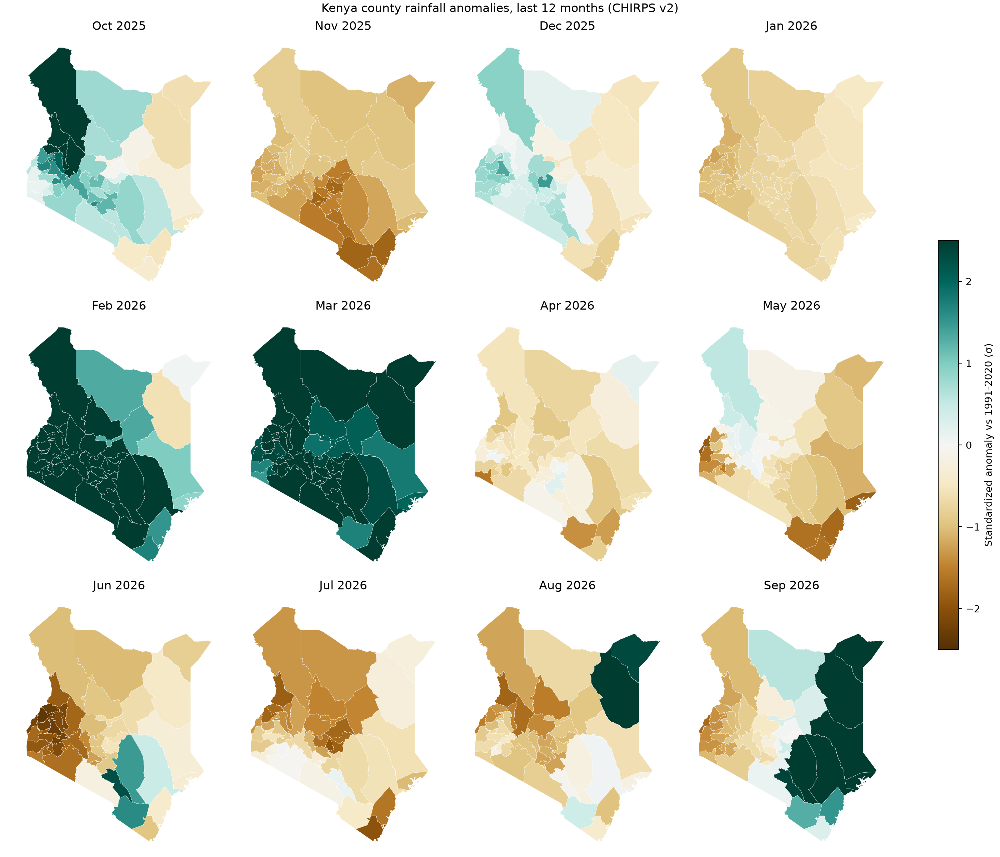
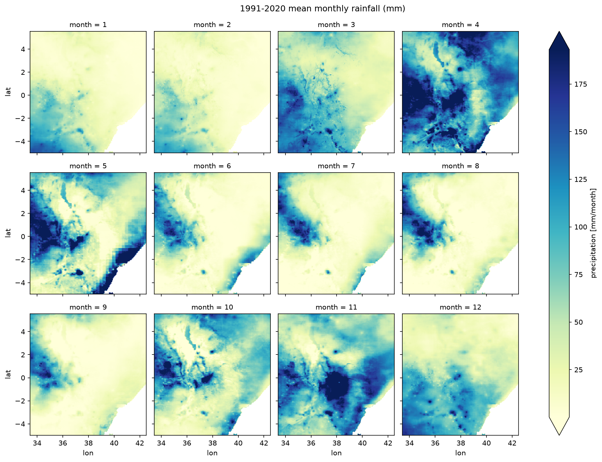
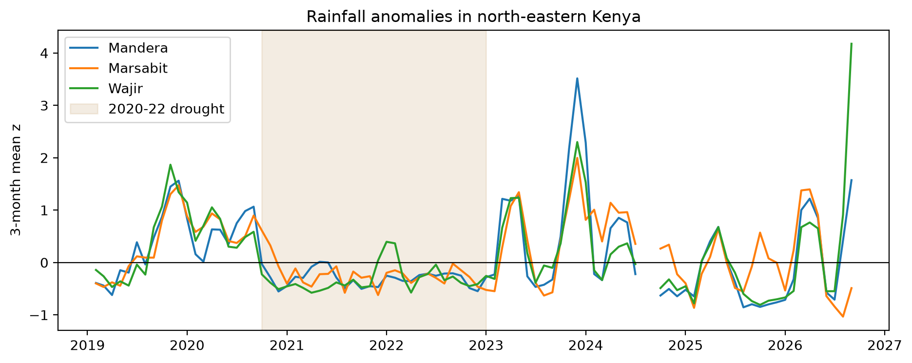

# Day 2: Rainfall anomalies with xarray

**Track:** GIS / climate · **Level:** Medium · **Time:** ~3 hours

Was each month wetter or drier than normal, and by how much, in each of Kenya's 47
counties? This pipeline turns 35 years of CHIRPS satellite rainfall into standardized
anomalies against the WMO 1991–2020 normal, averages them by county, and checks the
result against droughts and floods that really happened.



## What I built

- `get_data.py`: lists Digital Earth Africa's public S3 bucket of CHIRPS v2 monthly
  Cloud-Optimized GeoTIFFs, reads only the Kenya window of each month over HTTP, fills
  months missing from the bucket directly from the Climate Hazards Center (one request at
  a time), and stacks everything into one NetCDF cube with any remaining gaps made
  explicit. Also fetches Kenya's county boundaries (geoBoundaries API).
- `anomaly.py`: reusable functions: loader (checks units and axis order), monthly
  climatology, standardized anomaly, percent of normal, area-weighted county means.
- `analysis.py`: the narrative, as `# %%` cells: load → inspect → climatology →
  anomalies → county table → maps → validation.

## Method

For each pixel *i* and calendar month *m*:

```
z = (rainfall − mean of that calendar month, 1991–2020) / std of that calendar month
```

- **Baseline:** WMO standard normal, 1991–2020 (asserted to be 30 full years)
- **Dry-month guard:** z is set to NaN where the monthly normal is under 10 mm (or the
  monthly std under 1 mm). Evidence: before the guard, about 6 mm of rain in a month that
  normally gets 3–5 mm scored above +4σ over Mandera and Wajir
- **County means:** pixel-centre masks from `regionmask`, weighted by cos(latitude)
- **Property test:** z over the baseline must have mean ≈ 0 and std ≈ 1
- **Validation by season:** standardized anomalies of March–May and October–December
  totals, since monthly z dilutes failed rainy seasons with dry-season months

## Results



The climatology shows Kenya's two rainy seasons: the long rains (March–May) and the short
rains (October–December), with very dry months across the north and east.



_Data gaps: list any months still missing (`missing_months` in the cube) and whether they
fall in the validation window._

_Interpretation: write 2–3 sentences on whether the 2020–22 drought and the late-2023
floods show up in Mandera, Wajir and Marsabit, and anything surprising._

## Reproduce

```bash
uv sync
uv run day-02/get_data.py      # Kenya windows only, ~65 MB kept in data/day-02/ (ignored)
uv run day-02/analysis.py      # run from the repo root
```

## Pitfalls

| Pitfall | Symptom | Fix |
| --- | --- | --- |
| Relying on a mirror (IRI Data Library) | Request timed out after 10 min with no data | Use the original publisher (CHC) |
| Parallel downloads from an academic server (CHC) | 429, then 403, then a temporary IP block | One request at a time with pauses; bulk reads from cloud copies |
| Downloading whole continental files | Gigabytes for a Kenya-sized area | Read only the window you need from Cloud-Optimized GeoTIFFs |
| Assuming a cloud copy is complete | 4 months missing from the DE Africa bucket | Compare against the full date range; fill gaps from the publisher |
| Silent gaps in a time series | Months vanish from validation plots unnoticed | Reindex to the full range; missing months become explicit NaN |
| Mixing grids from two sources | xarray pads mismatched pixels with NaN | `xr.concat(..., join="exact")` fails loudly instead |
| One flaky request kills the whole run | Hours of downloading lost | Retries with backoff; skip files already saved |
| Half-written files after a crash | Corrupt file that looks complete | Write to `.part`, rename when done |
| Non-standard time axes in the wild (e.g. IRI's "months since 1960") | xarray decode error | `decode_times=False`, convert manually |
| Latitude stored north-to-south | Map upside down; empty `lat` slices | `sortby("lat")` at load |
| Units not checked | Anomalies off by ~30× (mm/day vs mm/month) | Read and set `attrs["units"]` |
| Non-standard baseline | Numbers don't match bulletins | 1991–2020, asserted |
| Near-zero std in dry months | Absurd ±20σ values | Mask where std < 1 mm |
| No area weighting | Bias grows away from the equator | Weight by cos(latitude) |
| CRS mismatch | Empty or shifted county means | Both in EPSG:4326 |
| Small counties | Noisy means from few pixels | Fractional-coverage masks (stretch) |
| Judging droughts from monthly z | A historic drought looks like −0.4σ | Assess seasonal totals (MAM, OND) |
| Trusting z for skewed rainfall | Severe failures capped near −0.6σ | Check the floor (−mean/std); report % of normal; use SPI |
| Summary statistics over the download box | Max came from Pemba Island, outside Kenya | Mask to the study area first |
| Scoring incomplete seasons | Season with a missing month undercounted | `sum(min_count=len(months))` leaves it NaN |
| Sequential colours for anomalies | "Normal" looks extreme | Diverging map centred on 0 (`BrBG`) |
| `zip` over unequal lengths | Silently missing panels | `zip(..., strict=True)` (ruff B905) |

## Cheatsheet

```python
import xarray as xr

ds = xr.open_dataset(path)                     # lazy open; decode_times=False if it fails
ds = xr.open_dataset(path, chunks={"time": 120})  # dask-backed, for big data
da = ds["precipitation"]                       # Dataset -> DataArray
da.sizes, da.dims, da.coords, da.attrs         # inspect

da.sel(time="2023-11")                         # select by label
da.sel(time=slice("1991", "2020"))             # label range (inclusive)
da.sel(lat=-1.29, lon=36.82, method="nearest") # nearest pixel
da.isel(time=-1)                               # select by position
da.sortby("lat")                               # fix descending coords
da.rename({"X": "lon"})                        # rename dims/coords

da.mean("time")                                # reduce over a dimension
da.groupby("time.month").mean("time")          # climatology (12 maps)
da.groupby("time.month") - clim                # anomaly, matched by month
da.resample(time="QS-DEC").sum()               # seasonal totals (DJF, MAM, ...)
da.rolling(time=3).mean()                      # 3-month running mean
da.where(da > 0)                               # mask (False -> NaN)
da.weighted(w).mean(("lat", "lon"))            # weighted spatial mean

da.plot(robust=True)                           # quick map, 2-98% colour range
da.plot(col="month", col_wrap=4)               # small multiples
da.to_dataframe(name="value").reset_index()    # to a tidy pandas table
da.to_netcdf("out.nc")                         # save
```

```python
# Crop a big raster without reading all of it (rasterio)
from rasterio.io import MemoryFile
from rasterio.windows import from_bounds

with MemoryFile(raw_bytes) as mem, mem.open() as src:          # file already in memory
    window = from_bounds(west, south, east, north, src.transform)
    window = window.round_offsets().round_lengths()
    data = src.read(1, window=window)                          # only the box
    transform = src.window_transform(window)                   # georeference for the box
```

```python
import regionmask

regions = regionmask.from_geopandas(gdf, names="shapeName", overlap=False)
mask = regions.mask_3D(da.lon, da.lat)         # region x lat x lon booleans
means = da.weighted(mask * np.cos(np.deg2rad(da.lat))).mean(("lat", "lon"))
```

| Anomaly type | Formula | Use when |
| --- | --- | --- |
| Absolute | x − mean | Same place, units matter (mm) |
| Percent of normal | 100 × x / mean | Communicating to non-specialists |
| Standardized (z) | (x − mean) / std | Comparing places with different climates |
| SPI | gamma fit → normal score | Operational drought monitoring |

## Reflections

1. Why anomalies instead of raw rainfall (with an example)
2. What `groupby("time.month") - clim_mean` does, and what goes wrong with one overall mean
3. z = +3 in February: one real explanation, one artefact
4. Why baseline z has mean ≈ 0 and std ≈ 1, and what bug would break it
5. When cos-latitude weighting matters
6. Trusting Mombasa's anomaly, and how to fix it
7. Why a 2-month-old rainfall anomaly might predict malaria better than this month's

## Data and credits

- CHIRPS v2.0 Africa monthly, [Climate Hazards Center](https://www.chc.ucsb.edu/data/chirps),
  UC Santa Barbara (public domain), via
  [Digital Earth Africa on AWS](https://registry.opendata.aws/deafrica-chirps/).
  Funk et al. (2015), [Scientific Data 2, 150066](https://www.nature.com/articles/sdata201566).
- Kenya county boundaries: [geoBoundaries](https://www.geoboundaries.org/) gbOpen ADM1 (CC BY 4.0).
