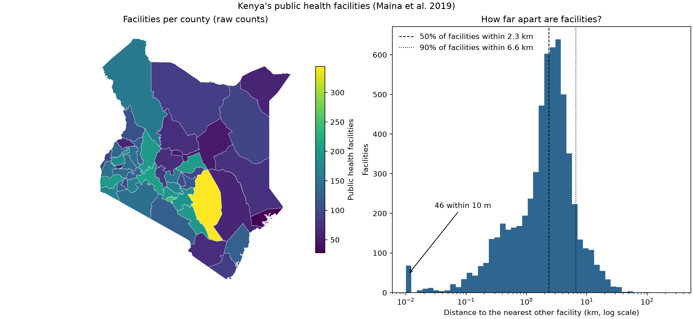

# Day 3: GeoParquet and spatial SQL with DuckDB

**Track:** Data engineering / GIS · **Level:** Medium · **Time:** ~3 hours

A 98,745-row health facility database for sub-Saharan Africa, taken from an Excel file to
GeoParquet and queried with spatial SQL in DuckDB: how many public facilities each Kenyan
county has, how far apart they are, and how much of the data can be trusted.



Half of Kenya's public facilities have another facility within **2.3 km**, and 90% within
**6.6 km**; the long right tail is mostly the arid north and east. The map shows raw counts,
which mislead: Kitui (344) leads partly because it is vast, Mombasa is lowest partly because
it is small. Counts per person and per area come on Day 4.

## What I built

- `build.py`: downloads the facility list (Maina et al. 2019, via HDX), standardises the
  schema, moves rows with missing or impossible coordinates to a rejected file with a
  reason, and writes GeoParquet for all of sub-Saharan Africa, Kenya (with coordinates
  projected to metres, EPSG:21037) and Kenya's counties.
- `sql/`: one query per file: facilities per county, facilities outside every county,
  Admin1 label vs location, and brute-force nearest neighbour.
- `analysis.py`: format comparison, the queries, a KD-tree nearest-neighbour check against
  the SQL, a benchmark, and the figure.

## Data quality findings

Every row in the source file has coordinates, and every one falls inside a generous box
around sub-Saharan Africa, so a coarse check rejects nothing. Finer checks tell a different
story: **zero rejected means "no obviously broken rows", not "no errors".**

| Check | Result |
| --- | --- |
| Missing or impossible coordinates | 0 rows |
| Coordinates at exactly (0, 0), "Null Island" | _n rows (from the `build.py` output), now rejected with their own reason_ |
| Kenyan facilities outside every county (before the Null Island fix) | 109, almost all at (0, 0) |
| Kenyan facilities outside every county (after the fix) | _n, the genuine oddities_ |
| Admin1 label agrees with location | _x% of located facilities_ |
| Facilities within 10 m of another | _n (annotated on the figure)_ |

**Null Island.** Most facilities that fell outside every Kenyan county sat at longitude 0,
latitude 0 with no location source: missing coordinates saved as zeros, a point in the
Gulf of Guinea. (0, 0) lies inside the Africa box, so it passed the first check. The county
anti-join caught it, and `build.py` now rejects these rows explicitly. Left in, they would
also have paired with each other at 0 m in the nearest-neighbour step and inflated the
duplicate count.

**A likely sign error.** Ringiti Dispensary (Homa Bay) is recorded at latitude +0.4547.
Ringiti is an island in Lake Victoria in Homa Bay County, south of the equator, so the true
latitude is very likely −0.4547: a dropped minus sign moves the point about 100 km north.

_One or two sentences on the Admin1 mismatches and the duplicates once you have the numbers:
spelling, border effects, old administrative names, or real errors?_

## Formats

The same 98,745 rows, read five ways (fastest of three runs; Excel timed once):

| Format | Size (MB) | Read time (s) |
| --- | --- | --- |
| Excel (.xlsx) | 5.2 | 7.5 |
| CSV | 10.3 | 0.03 |
| GeoPackage | 19.7 | 0.64 |
| GeoParquet, all columns | 7.1 | 0.11 |
| GeoParquet, 2 columns (DuckDB) | 7.1 | 0.05 |

- **The fair comparison is GeoParquet vs GeoPackage**, since both carry geometry and
  types: GeoParquet is about 2.8× smaller and 6× faster to read.
- **CSV only looks fastest** because it does less work: no geometry, no types.
- **Excel costs ~7.5 s on every read**, about 70× slower than GeoParquet. So `build.py`
  reads it once and every later step reads GeoParquet: convert at the edge, then work in
  a good format.
- **Reading 2 columns instead of all** is about 2.3× faster here. That gain is modest
  because the table is small and narrow; it grows with wider and longer tables.

## Benchmark

_Paste `benchmark.csv` here as a table._

## When to use which

_In your own words, with your numbers as evidence:_

1. _Which format to store and share this dataset in, and why_
2. _When DuckDB SQL beats geopandas, and the other way round_
3. _What the nearest-neighbour comparison shows about engines versus algorithms_

## Reproduce

```bash
uv sync
uv run day-03/build.py       # ~5 MB download into data/day-03/ (ignored by Git)
uv run day-03/analysis.py    # run from the repo root
```

## Pitfalls

| Pitfall | Symptom | Fix |
| --- | --- | --- |
| Distances in degrees | Values like 0.03; wrong away from the equator | Project to metres (EPSG:21037 for Kenya) |
| Latitude and longitude swapped | Points in the sea or on another continent | Plot first; check ranges; read each function's axis order |
| Silently dropping bad rows | Totals don't add up | Keep rejected rows with a reason |
| Geometry read as BLOB | `ST_Within` fails on the column type | Load `spatial` first, or `ST_GeomFromWKB(geometry)` |
| `INNER JOIN` for counts per area | Areas with zero facilities disappear | `LEFT JOIN` |
| `count(*)` after a `LEFT JOIN` | Empty areas show 1, not 0 | Count a column from the joined table |
| Benchmarking unchecked results | A "fast" method that's wrong | Assert results match first |
| Timing a single run | Noisy, unrepeatable numbers | Repeat; take the minimum |
| Brute-force pairs at scale | Work grows with n² | Spatial index: KD-tree or R-tree |
| Raw counts read as access | Large counties look best served | Normalise by population or area |
| Ties in nearest neighbour | Methods pick different "nearest" ids at 0 m | Compare distances, not ids |
| A coarse validity box | (0, 0) "Null Island" rows pass as valid | Reject (0, 0) explicitly; layer finer checks |
| Trusting coordinate signs | A facility 100 km away across the equator | Check points against their stated area |
| Ambiguous names (`l`, `1`, `I`, `O`, `0`) | `AS 1` typed for `AS l`, a parse error | Descriptive names (`located_key`) |
| The same file name typed in two scripts | `ssa.facilities.parquet` vs `ssa_facilities.parquet` | Define each path once (DRY) |
| Misspelled package names | `uv add duckb` fails, or installs a lookalike (typosquatting) | Read the names uv prints; review `pyproject.toml` |
| Lower-case `ckdtree` | `'module' object is not callable` | The class is `cKDTree` |
| Text pinned onto a chart | Labels overlap when values sit close together | Use a legend |
| Hunting typos one run at a time | Many slow round trips | `git diff --no-index` against a known-good file; `ruff check` before running |

## Cheatsheet

```python
import duckdb

con = duckdb.connect()                     # in-memory database, no server
con.install_extension("spatial")           # once per machine
con.load_extension("spatial")              # every session
con.sql("CREATE VIEW f AS SELECT * FROM 'data/file.parquet'")
con.sql("DESCRIBE f")                      # column names and types
df = con.sql(open("query.sql").read()).df()  # run a .sql file into pandas
```

```sql
-- Read files directly
SELECT * FROM 'data/*.parquet';                    -- many files at once
SELECT country, count(*) FROM 'f.parquet' GROUP BY ALL;

-- Spatial predicates and joins
SELECT c.name, count(p.id) AS n
FROM areas c LEFT JOIN points p ON ST_Within(p.geometry, c.geometry)
GROUP BY c.name;

-- Anti-join: rows with no match
SELECT * FROM points p
WHERE NOT EXISTS (SELECT 1 FROM areas c WHERE ST_Within(p.geometry, c.geometry));

-- Value at the minimum of another column
SELECT id, arg_min(other_id, dist) AS nearest, min(dist) AS dist FROM pairs GROUP BY id;

-- Readable multi-step queries
WITH step1 AS (...), step2 AS (SELECT ... FROM step1) SELECT ... FROM step2;

-- Handy functions
ST_Point(x, y)  ST_X(geom)  ST_Y(geom)  ST_Area(geom)  ST_Buffer(geom, d)
ST_GeomFromWKB(blob)  ST_AsText(geom)  regexp_replace(s, pattern, '', 'g')
```

```python
import geopandas as gpd
from scipy.spatial import cKDTree

gdf.to_parquet("out.parquet", write_covering_bbox=True)   # GeoParquet with bbox column
gdf = gpd.read_parquet("out.parquet", columns=["id", "geometry"])
gdf.to_crs("EPSG:21037")                                  # project to metres (Kenya)
gpd.sjoin(points, areas, predicate="within")              # spatial join
dist, idx = cKDTree(xy).query(xy, k=2)                    # nearest other point: column 1
```

| Format | Use for |
| --- | --- |
| GeoParquet | Analytics, sharing large tables, cloud storage |
| GeoPackage | Editing in QGIS, exchanging layers with GIS users |
| GeoJSON | Small data for the web |
| CSV | Plain tables for anyone, no geometry or types |
| Shapefile | Only when a tool demands it |

## Reflections

1. Why reading 2 columns from GeoParquet is fast, and why that fails for CSV
2. Three reasons county counts could fall short of the Kenya total, and how to tell them apart
3. Why nearest neighbour uses `x_m`, `y_m` instead of `geometry`
4. Brute force at sub-Saharan Africa scale vs the KD-tree
5. Why the methods are compared on distances, not ids
6. A precise version of "DuckDB is faster than geopandas"
7. Where these checks would have caught a problem in my SNT work

## Data and credits

- Maina, J. et al. (2019). A spatial database of health facilities managed by the public
  health sector in sub Saharan Africa. *Scientific Data* 6, 134.
  [doi:10.1038/s41597-019-0142-2](https://doi.org/10.1038/s41597-019-0142-2) (CC BY 4.0),
  via the [Humanitarian Data Exchange](https://data.humdata.org/dataset/health-facilities-in-sub-saharan-africa).
- Kenya county boundaries: [geoBoundaries](https://www.geoboundaries.org/) gbOpen ADM1 (CC BY 4.0).
