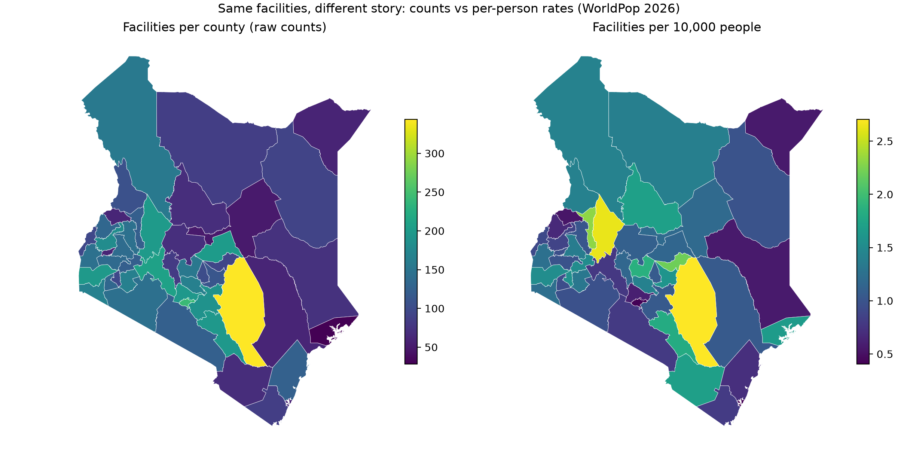
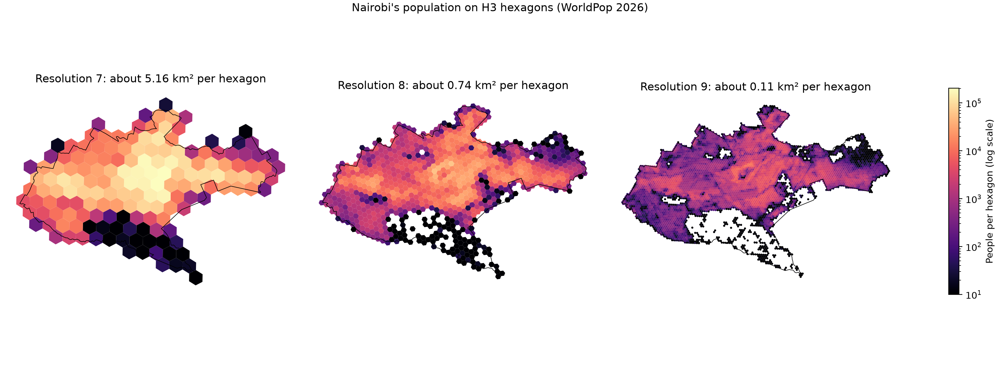

# Day 4: Population, H3 hexagons and the modifiable areal unit problem

**Track:** GIS · **Level:** Easy to medium · **Time:** ~2.5 hours

How many people does each public health facility serve, and how much does the answer depend
on the units we count in? This adds WorldPop's 2026 population estimate to Day 3's
facilities: first per county, then for Nairobi on Uber's H3 hexagons at three resolutions,
where it measures the modifiable areal unit problem (MAUP) directly.



_Two or three sentences: which counties move most between the panels, and why._

[Interactive map of Nairobi (resolution 8)](nairobi_h3.html): download and open in a browser.

## What I built

- `get_data.py`: finds Kenya's 2026 WorldPop file (Global 2, R2025A, 100 m, constrained)
  through WorldPop's REST API, falls back to the documented file pattern if the API is
  unavailable (and says so), and downloads it once.
- `analysis.py`:
  - the national total, read block by block to stay within memory
  - population per county by windowed zonal sums, with a conservation check
  - facilities per 10,000 people per county (`county_per_capita.csv`)
  - Nairobi's populated pixels turned into points and aggregated to H3 resolutions 7, 8
    and 9, with population conserved at every step
  - the MAUP table (`maup.csv`) and an interactive deck.gl map (`nairobi_h3.html`)

## Results

_Fill in with your numbers._

| Check | Result |
| --- | --- |
| Kenya total population, 2026 (WorldPop) | _n; my prediction was n_ |
| Share of the raster total outside all counties (`gap`) | _x%, and why it isn't zero_ |
| Nairobi: populated pixels, people, public facilities | _n, n, n_ |

### The MAUP, measured

_Paste `maup.csv` here as a table._



_Interpretation: what happens to "unserved, same hexagon" as hexagons shrink; why "within
about 2 km" is more stable; why it still isn't perfectly constant (coarse cells, ring
distance not exactly 2 km, edge hexagons)._

**Takeaway:** define access by something physical (distance, travel time), never as
"sharing a unit", then choose units fine enough not to blur it.

## Caveats

- WorldPop estimates are a model, not a census, and Global 2 (R2025A) is described by
  WorldPop as an early release that may be revised. Numbers are rounded for that reason.
- The facility list covers **public** facilities only (Maina et al. 2019). In Nairobi
  especially, many people use private and faith-based care that isn't counted here.
- Straight-line distance is a rough proxy for access; travel time comes on Day 6.

## Reproduce

```bash
uv sync
uv run day-03/build.py        # facilities and counties, if not already built
uv run day-04/get_data.py     # WorldPop raster into data/day-04/ (ignored by Git)
uv run day-04/analysis.py     # run from the repo root
```

## Pitfalls

| Pitfall | Symptom | Fix |
| --- | --- | --- |
| Mapping raw counts | Big counties look best served | Divide by population or area |
| Reading a national raster at once | Memory errors, frozen laptop | Block-by-block or windowed reads |
| 32-bit sums of millions of pixels | Totals drift | `sum(dtype="float64")` |
| Nodata counted as people | Absurd totals | `masked=True`, then `.filled(0)` |
| Longitude first into H3 | Hexagons in the wrong place | `latlng_to_cell(lat, lon, res)` |
| `cell_to_boundary` order | Polygons drawn with swapped axes | Swap to (lon, lat) for shapely |
| Access as "in the same unit" | Answer changes with unit size (MAUP) | Define by distance or travel time |
| Hexagons finer than pixels | Hexagons with one pixel or none | Stay coarser than the source data |
| Edge hexagons | Border cells look sparse | Clip, flag or exclude partial cells |
| Silent fallbacks | API changes go unnoticed | Print a message whenever a fallback is used |
| False precision | "1,243,571 people" | Round, cite the release and its status |

## Cheatsheet

```python
import h3

cell = h3.latlng_to_cell(lat, lon, res)           # point -> hexagon id (latitude first!)
h3.cell_to_latlng(cell)                           # hexagon centre as (lat, lon)
h3.cell_to_boundary(cell)                         # corners as (lat, lon) pairs
h3.grid_disk(cell, k)                             # the cell plus everything within k rings
h3.cell_to_parent(cell, res - 1)                  # coarser hexagon containing this one
h3.cell_to_children(cell, res + 1)                # finer hexagons inside this one
h3.average_hexagon_area(res, unit="km^2")         # typical size at a resolution
h3.average_hexagon_edge_length(res, unit="km")    # centre spacing = sqrt(3) x edge
```

```python
import rasterio
from rasterio.mask import mask

with rasterio.open(path) as src:
    src.crs, src.res, src.shape, src.nodata          # inspect first
    for _, window in src.block_windows(1):            # stream a big raster in blocks
        block = src.read(1, window=window, masked=True)
    data, transform = mask(src, [geom], crop=True, filled=False)  # one polygon's window
rows, cols = np.nonzero(~np.ma.getmaskarray(band) & (band.filled(0) > 0))
xs, ys = rasterio.transform.xy(transform, rows, cols)             # pixel centres
```

```python
import pydeck as pdk

layer = pdk.Layer("H3HexagonLayer", df, get_hexagon="cell", get_fill_color="colour",
                  pickable=True)
deck = pdk.Deck(layers=[layer], initial_view_state=pdk.ViewState(latitude=..., longitude=...,
                zoom=10), tooltip={"text": "{people}"})
deck.to_html("map.html", open_browser=False)      # a self-contained web map
```

| H3 resolution | Average area | Edge | Roughly |
| --- | --- | --- | --- |
| 5 | 252.9 km² | 9.9 km | a district |
| 7 | 5.16 km² | 1.41 km | a small town |
| 8 | 0.74 km² | 0.53 km | a neighbourhood |
| 9 | 0.11 km² | 0.20 km | a few city blocks |

## What I learned

_My answers to the check questions, in my own words._

1. A county that moves between counts and rates, and why
2. Why `raster_total` reads in blocks
3. What the `gap` means, and when it would worry me
4. The MAUP, with my table as the example
5. Why "within 2 km" is more stable than "same hexagon", and why not perfectly
6. Where latitude-first vs longitude-first mattered today
7. Where the MAUP could change a decision in SNT work, and how I'd check

## Data and credits

- Population: WorldPop Global 2, constrained estimates 2015–2030, 100 m, R2025A v1
  (Bondarenko et al. 2025), [doi:10.5258/SOTON/WP00839](https://doi.org/10.5258/SOTON/WP00839)
  (CC BY 4.0).
- Facilities: Maina et al. (2019), *Scientific Data* 6, 134,
  [doi:10.1038/s41597-019-0142-2](https://doi.org/10.1038/s41597-019-0142-2) (CC BY 4.0).
- Kenya county boundaries: [geoBoundaries](https://www.geoboundaries.org/) gbOpen ADM1 (CC BY 4.0).
- Hexagons: [H3](https://h3geo.org/), Uber Technologies (Apache 2.0).
