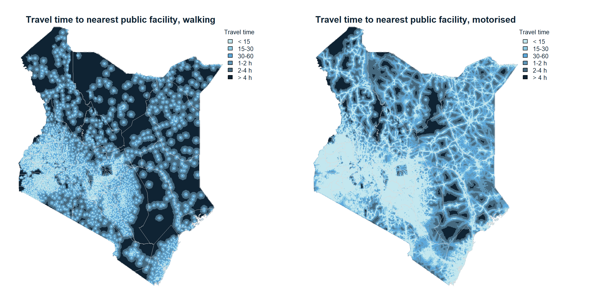
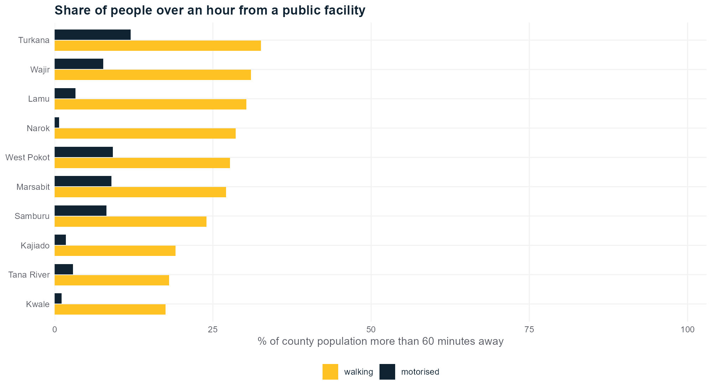

# Day 6: Travel time to care

**Track:** GIS / spatial epidemiology · **Language:** R · **Level:** Hard · **Time:** ~3 hours

How long does it take every person in Kenya to reach the nearest public health facility,
on foot and by motor vehicle? Built from the Malaria Atlas Project's friction surfaces,
Day 3's facility list and Day 4's WorldPop population, using cost-distance in `terra`.



## What I built

- `travel_time.R`, in seven sections:
  1. MAP's walking and motorised friction surfaces for Kenya, fetched once by dataset ID
  2. Counties, facilities (filtered to points inside a county) and population on one
     1 km grid, with a population conservation check
  3. Cost-distance from every facility, for both surfaces (minutes)
  4. Share of each county's population within 30, 60 and 120 minutes, and the
     population-weighted mean journey (`county_access.csv`)
  5. Classified travel-time maps
  6. The ten counties with the largest share of people over an hour away on foot
  7. Validation against MAP's published walking travel-time-to-healthcare map
- `R/ahadi_style.R`: the AHADI house style for R, matching `src/geokit/style.py`

## Results

_Fill in with your numbers._

| Measure | Walking | Motorised |
| --- | --- | --- |
| Kenyans within 60 minutes of a public facility | _x% (I predicted y%)_ | _x% (I predicted y%)_ |
| Population kept on the 1 km grid | _~100%_ | |
| Public facilities used | _n (inside a county)_ | |



_Two or three sentences: which counties are worst served, and where the gap between
walking and motorised access is largest. What does a large gap suggest (transport as the
barrier) compared with a county where both are poor (too few facilities)?_

### Validation against MAP's travel-time map

| Check | Result |
| --- | --- |
| Populated cells compared | _n_ |
| Correlation of log travel times | _r_ |
| Median ratio, ours ÷ MAP | _x_ |

_Interpretation: do the two maps agree on which places are near and far? If ours are
longer, why (MAP used a larger, global facility database)?_

## Limitations

- **Public facilities only** (Maina et al. 2019). Private and faith-based facilities
  outside the public list are missing, so travel times are upper bounds where those exist.
- **No cross-border facilities.** People near borders may use clinics in neighbouring
  countries; their travel times here are overestimates.
- **Friction for a nominal 2019.** Roads built since then are not included.
- **Nearest facility, by quickest route.** No account of capacity, opening hours, services
  offered, cost, or seasonal flooding.
- **Eight-direction movement** on a ~1 km grid: under 1% error on a test route.

## Reproduce

```r
renv::restore()                           # R packages from renv.lock
# Needs data/day-02/kenya_adm1.geojson, data/day-03/ssa_facilities.csv and
# data/day-04/ken_pop_2026_100m.tif from Days 2-4.
source("day-06/travel_time.R")            # or: Rscript day-06/travel_time.R, from the repo root
```

## Pitfalls

| Pitfall | Symptom | Fix |
| --- | --- | --- |
| Friction read as speed | Wildly wrong times | Minutes per metre: time = friction × distance |
| Cost-distance in degrees | Off by ~100,000× | Test the tool; terra uses metres on lat/lon |
| `resample(method = "sum")` for counts | ~0.3% of people lost in testing | `aggregate(fun = "sum")` when grids nest; check totals |
| Facilities outside the study area | Fake short times near borders | `st_filter` to counties first |
| `library()` for many packages | Functions silently masked (`dplyr::filter` vs `stats::filter`) | `package::function` everywhere |
| Unreachable people dropped | Access looks better than it is | Keep them in the denominator |
| Area-weighted means | Empty land dominates | Weight by population |
| Continuous scale for skewed times | One colour for most of the map | Labelled classes |
| Legend drawn over dark map areas | Invisible legend text | Put the legend outside the map |
| Neighbouring countries in the box | Look hopelessly far | `mask` and `crop` to the study area |
| One mode as "the" answer | One-sided conclusions | Report walking and motorised |

## Cheatsheet

```r
# MAP rasters for a box (rows x, y; columns min, max)
box <- matrix(c(xmin, ymin, xmax, ymax), nrow = 2, dimnames = list(c("x", "y"), c("min", "max")))
fr <- malariaAtlas::getRaster(
  dataset_id = "Accessibility__202001_Global_Walking_Only_Friction_Surface", extent = box
)

# Travel time from points over a friction surface (minutes per metre in, minutes out)
src <- terra::rasterize(terra::vect(points_sf), fr, field = 1)
cost <- terra::ifel(!is.na(src), 0, fr)
tt <- terra::costDist(cost, target = 0)

# Counts between resolutions: sum, never average; then check the total
pop_1km <- terra::aggregate(pop_100m, fact = 10, fun = "sum", na.rm = TRUE) |>
  terra::resample(fr, method = "near")

# Population-weighted summaries per polygon
terra::zonal(pop * (tt <= 60), terra::vect(polygons_sf), fun = "sum", na.rm = TRUE)

# Labelled classes for a map
k <- terra::classify(tt, rcl = c(0, 15, 30, 60, 120, 240, Inf), include.lowest = TRUE, right = FALSE)
levels(k) <- data.frame(id = 0:5, label = c("< 15", "15-30", "30-60", "1-2 h", "2-4 h", "> 4 h"))
terra::plot(k, col = ahadi_sequential(7)[-1], all_levels = TRUE)
```

**Convention:** every function is called as `package::function`, with no `library()` calls.
Base R functions, and operators or indexing on terra objects (`tt[[1]]`, `pop * (tt <= 60)`),
stay unprefixed: they work once the first `terra::` call has loaded the package.

| MAP dataset ID | What it is |
| --- | --- |
| `Accessibility__202001_Global_Walking_Only_Friction_Surface` | Walking friction, min/m |
| `Accessibility__202001_Global_Motorized_Friction_Surface` | Motorised friction, min/m |
| `Accessibility__202001_Global_Walking_Only_Travel_Time_To_Healthcare` | MAP's walking travel time, minutes |
| `Accessibility__202001_Global_Motorized_Travel_Time_to_Healthcare` | MAP's motorised travel time, minutes |

## Reflections

1. Time to cross a 930 m pixel at 0.015 min/m, and the equivalent speed
2. Cost-distance, in the "water spreading from every facility" picture
3. Why `aggregate` rather than `resample(method = "sum")`
4. Unreachable people in the denominator; population-weighted means
5. A county with a big walking–motorised gap, and what it suggests
6. Two reasons my times are longer than MAP's
7. Using travel time to judge whether low reported incidence is real or an access artefact

## Data and credits

- Friction surfaces and travel time to healthcare: Weiss, D. J. et al. (2020). Global maps
  of travel time to healthcare facilities. *Nature Medicine* 26, 1835–1838.
  [doi:10.1038/s41591-020-1059-1](https://doi.org/10.1038/s41591-020-1059-1) (CC BY 4.0),
  via the [`malariaAtlas`](https://cran.r-project.org/package=malariaAtlas) R package.
- Facilities: Maina et al. (2019), *Scientific Data* 6, 134 (CC BY 4.0), via Day 3.
- Population: WorldPop Global 2, R2025A (CC BY 4.0), via Day 4.
- Counties: geoBoundaries gbOpen ADM1 (CC BY 4.0), via Day 2.
- Figures use the AHADI house style from `R/ahadi_style.R`.
