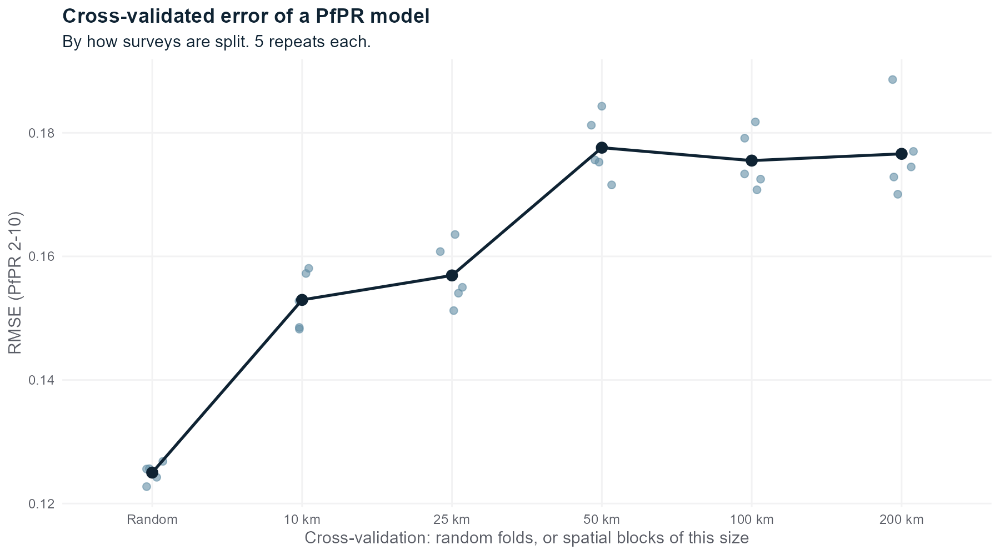
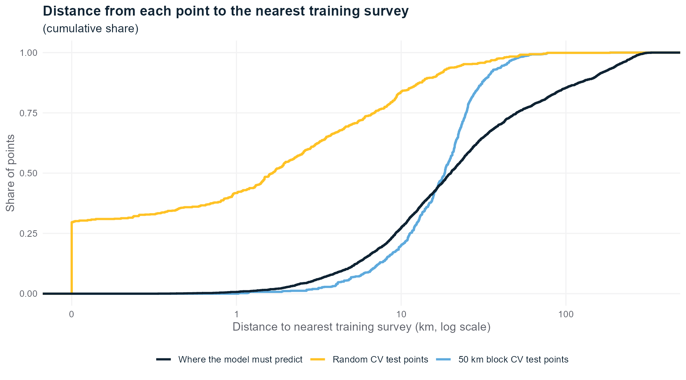

# Day 8: Spatial cross-validation

**Track:** Spatial data science · **Language:** R · **Level:** Medium · **Time:** ~3 hours

Does the usual way of testing a model tell the truth when the data sit on a map? A random
forest model of malaria prevalence (PfPR₂₋₁₀) in Kenya, fitted to open MAP survey data
with covariates built on earlier days, tested with random folds and with spatial blocks of
10 to 200 km, then checked against the distances the model must bridge in real use.



## What I built

- `spatial_cv.R`, in six sections:
  1. Open, geolocated *P. falciparum* surveys for Kenya from the Malaria Atlas Project,
     2005 onwards, at least 10 people examined, standardised to ages 2–10
  2. Covariates at each survey: elevation (new), mean annual rainfall 1991–2020 (Day 2),
     log population per km² (Day 4), walking travel time (Day 6), and survey year
  3. A random forest (`ranger`, weighted by people examined), and hand-written fold
     functions for random and spatial-block cross-validation
  4. Random CV vs 10, 25, 50, 100 and 200 km blocks, 5 repeats each (`cv_results.csv`)
  5. Figure: estimated error by block size
  6. Figure: distance from test points to the nearest training survey, compared with
     the distance from real prediction locations to the nearest survey

## Results

_Fill in with your numbers._

| Check | Result |
| --- | --- |
| Surveys used / distinct locations / years | _n / n / yyyy–yyyy_ |
| RMSE, random CV | _x (± sd)_ |
| RMSE, chosen block size (_n km_) | _x (± sd)_ |
| Difference | _+x%_ |



| Points | Median distance to nearest training survey |
| --- | --- |
| Where the model must predict | _x km_ |
| Random CV test points | _x km_ |
| 50 km block CV test points | _x km_ |

**Honest estimate.** _Which block size's test distances best match the prediction
distances, and the RMSE you'd report for this model as a result. One sentence on how
misleading the random-CV number would have been._

## Limitations

- **Covariate years don't match survey years.** Population is for 2026, travel time for a
  nominal 2019, rainfall a 1991–2020 average; surveys span 2005 onwards.
- **Only open, geolocated surveys.** DHS clusters are excluded because their coordinates
  can't be redistributed, which leaves gaps in coverage.
- **A simple model.** No explicit spatial term; a geostatistical model (Day 12) would use
  the spatial structure that this model leaves in its errors.
- **Age standardisation is itself a model** (Smith et al. 2007), adding uncertainty that
  isn't propagated here.

## Reproduce

```r
renv::restore()
# Needs Day 2 (CHIRPS cube, counties), Day 4 (WorldPop) and Day 6 (travel time) outputs.
source("day-08/spatial_cv.R")   # or: Rscript day-08/spatial_cv.R, from the repo root
```

## Pitfalls

| Pitfall | Symptom | Fix |
| --- | --- | --- |
| Random CV on spatial data | Optimistic error estimate | Spatial blocks, checked against prediction distances |
| Repeat surveys at a site in train and test | Test points at 0 km from training data | Split by location, not by row |
| Blocks too large | Pessimistic error estimate | Match test distances to prediction distances |
| A single CV run | Differences that are just luck | Repeat and report the spread |
| Raw prevalence across age groups | Surveys not comparable | Standardise to PfPR₂₋₁₀ |
| Blocks in degrees | Blocks change size with latitude | Metre-based CRS (EPSG:21037) |
| No seed | Numbers change every run | `set.seed()` at the top |
| Variables named `table`, `points` | Shadow base R functions | Descriptive names |
| Selecting a time window by layer number | Silently wrong months | Select by date; `stopifnot` the count |

## Cheatsheet

```r
# MAP survey data, standardised to PfPR 2-10
pr <- malariaAtlas::getPR(country = "Kenya", species = "Pf")
pr$pfpr <- malariaAtlas::convertPrevalence(pr$positive / pr$examined, pr$lower_age,
                                           pr$upper_age, 2, 10)

# Covariates at points
vals <- terra::extract(raster, terra::vect(points_sf), ID = FALSE)[, 1]
rain <- terra::mean(chirps[[which(terra::time(chirps) <= as.Date("2020-12-31"))]]) * 12

# Random folds and spatial block folds (xy in metres)
random_folds <- sample(rep_len(1:5, n))
block <- paste(floor(xy[, 1] / 50000), floor(xy[, 2] / 50000))
block_folds <- sample(rep_len(1:5, length(unique(block))))[match(block, unique(block))]

# Random forest, weighted by sample size
model <- ranger::ranger(x = train[features], y = train$pfpr, case.weights = train$examined)
stats::predict(model, test[features])$predictions

# Nearest-neighbour distances, brute force (fine for a few thousand points)
d2 <- outer(a[, 1], b[, 1], "-")^2 + outer(a[, 2], b[, 2], "-")^2
nearest <- sqrt(apply(d2, 1, min))
```

| Package | Use it for |
| --- | --- |
| `blockCV` | Spatial and buffered blocks, with block size suggested from autocorrelation range |
| `spatialsample` | Spatial resampling inside tidymodels |
| `CAST` | Distance-matched folds (`knndm`) and the area of applicability |

## What I learned

_My answers to the check questions, in my own words._

1. Why random CV flatters a spatial model, without the word "autocorrelation"
2. Why repeat surveys at the same sites make it worse
3. My Figure 1: random vs chosen block size, and the difference
4. The fairest block size from Figure 2, and whether blocks can be too large
5. Why standardise to PfPR₂₋₁₀
6. Why changing only the folds made a clean experiment
7. Three questions I'd ask about a colleague's MBG hold-out validation

## Data and credits

- PfPR surveys: Malaria Atlas Project, via the
  [`malariaAtlas`](https://cran.r-project.org/package=malariaAtlas) R package (open-access
  points; cite the original surveys as listed in the data).
- Age standardisation: Smith, D. L. et al. (2007). Standardizing estimates of the
  *Plasmodium falciparum* parasite rate. *Malaria Journal* 6, 131.
- Elevation: SRTM-derived 30 arc-second elevation, via
  [`geodata`](https://cran.r-project.org/package=geodata).
- Rainfall (Day 2), population (Day 4), travel time (Day 6): see those days' credits.
- Figures use the AHADI house style from `R/ahadi_style.R`.
